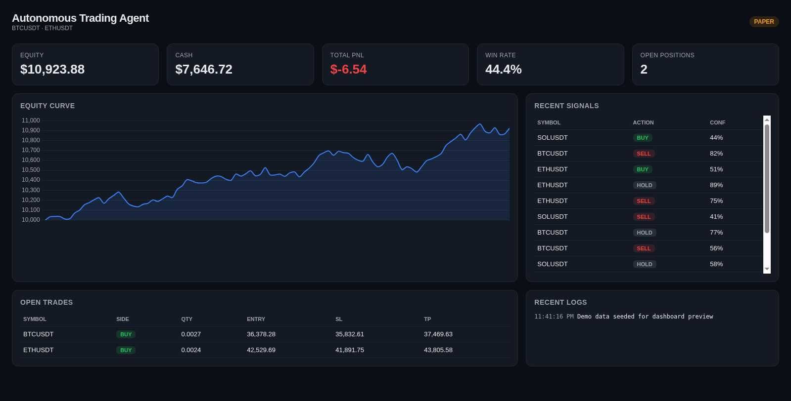

# Autonomous Trading Agent

A production-ready, fully autonomous quantitative trading agent. It researches
markets, generates and backtests strategies, executes trades, manages risk, and
continuously improves — designed to run 24/7 with minimal human input.

> **Safety first:** the agent defaults to **paper trading**. Live trading is
> opt-in via `TRADING_MODE=live` and requires your own exchange API keys.



> The screenshot above uses synthetic demo data (`scripts/seed_demo.py`) purely
> to showcase the UI.

---

## Architecture

```
                    ┌──────────────────────────────────────────┐
                    │            Orchestrator (main.py)         │
                    │  24/7 loop · scheduling · error handling  │
                    └───────────────┬──────────────────────────┘
                                    │
   ┌───────────────┬────────────────┼─────────────────┬────────────────┐
   ▼               ▼                ▼                 ▼                ▼
Market Analysis  Strategy Engine  Risk Manager   Trade Executor   Monitoring
(indicators,     (trend, mean-    (sizing, stops, (paper / live,   (metrics,
 regime, S/R)     reversion,       daily loss,     order routing)  Telegram,
                  breakout,        drawdown,                        Discord)
                  backtests)       kill switch)
   │               │                │                 │                │
   └───────────────┴────────────────┴─────────────────┴────────────────┘
                                    │
                         ┌──────────▼──────────┐
                         │  SQLite storage     │
                         │  trades · equity ·  │
                         │  signals · logs     │
                         └──────────┬──────────┘
                                    │
                         ┌──────────▼──────────┐
                         │  FastAPI Dashboard  │
                         │  PnL · win rate ·   │
                         │  positions · signals│
                         └─────────────────────┘
```

### Modules

| Module | Responsibility |
|--------|----------------|
| `market_analysis.py` | EMA/RSI/MACD/ATR/Bollinger/ADX, trend, regime, support/resistance |
| `strategy_engine.py` | TrendFollow, MeanReversion, Breakout + ensemble vote + backtester |
| `risk_management.py` | Position sizing, stop/target, daily loss, max drawdown, kill switch |
| `trade_execution.py` | Routes approved orders, records fills, manages exits |
| `monitoring.py` | Performance metrics, Telegram/Discord alerts, daily reports |
| `self_improvement.py` | Re-weights the strategy ensemble from backtest results |
| `llm.py` | Provider-agnostic LLM client (OpenAI/Anthropic) with rule fallback |
| `exchange/` | Binance/Bybit public data + paper-trading broker |
| `dashboard/` | FastAPI + Chart.js real-time dashboard |

---

## Quick start

```bash
# 1. install
python -m venv .venv && source .venv/bin/activate
pip install -r requirements.txt

# 2. configure
cp .env.example .env        # edit as needed (paper mode works with no keys)

# 3. backtest
python scripts/backtest.py --symbols BTCUSDT,ETHUSDT --timeframe 1h

# 4. run paper trading (5 cycles)
python scripts/run_paper.py --cycles 5

# 5. dashboard
python dashboard/app.py     # http://localhost:8000
```

Run the full 24/7 agent:

```bash
PYTHONPATH=src python -m trading_agent.main
```

---

## Risk controls

All limits are enforced in `risk_management.py` **before** any order is placed:

- **Max position size:** 2% of equity per trade (`MAX_POSITION_PCT`)
- **Risk per trade:** 1% of equity between entry and stop (`RISK_PER_TRADE_PCT`)
- **Daily loss limit:** 3% → triggers kill switch (`MAX_DAILY_LOSS_PCT`)
- **Max drawdown:** 15% peak-to-trough → triggers kill switch (`MAX_DRAWDOWN_PCT`)
- **Portfolio exposure cap:** 30% (`MAX_PORTFOLIO_EXPOSURE_PCT`)
- **Confidence gate:** only trade above `MIN_CONFIDENCE` (0.55)
- **Kill switch:** halts trading on abnormal behavior / API errors

---

## Configuration

All secrets live in `.env` (never committed). See `.env.example` for the full
list. The LLM layer is optional — with `LLM_ENABLED=false` the agent runs a
deterministic rule-based ensemble and needs no external API.

---

## Testing

```bash
pytest
```

Covers indicators, risk gates (including kill-switch paths), backtest metrics,
and the paper-trading engine.

---

## Live trading (advanced)

1. Create exchange API keys with **trade** permission (no withdrawal).
2. Set `EXCHANGE_API_KEY` / `EXCHANGE_API_SECRET` in `.env`.
3. Start on testnet (`EXCHANGE_TESTNET=true`), verify behavior, then flip
   `TRADING_MODE=live`.

**This software is provided for educational purposes. Trading is risky and you
can lose money. Use at your own risk.**

---

## Project layout

```
money-repo/
├── src/trading_agent/     # core package
│   ├── config.py  db.py  llm.py  main.py
│   ├── market_analysis.py  strategy_engine.py
│   ├── risk_management.py  trade_execution.py
│   ├── monitoring.py  self_improvement.py
│   └── exchange/          # base, binance, bybit, paper
├── dashboard/             # FastAPI app + HTML
├── scripts/               # backtest, run_paper, daily_report
├── tests/                 # pytest suite
├── config/  data/  logs/
├── requirements.txt  .env.example  Dockerfile
```
